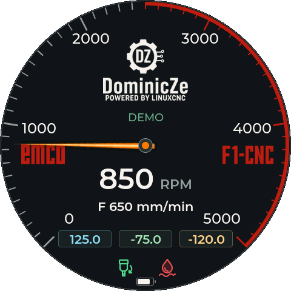
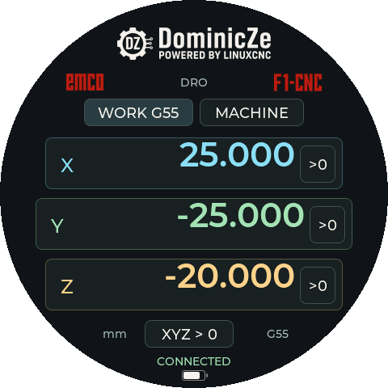
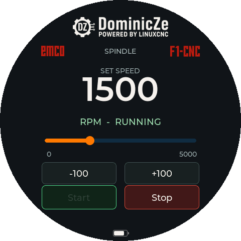
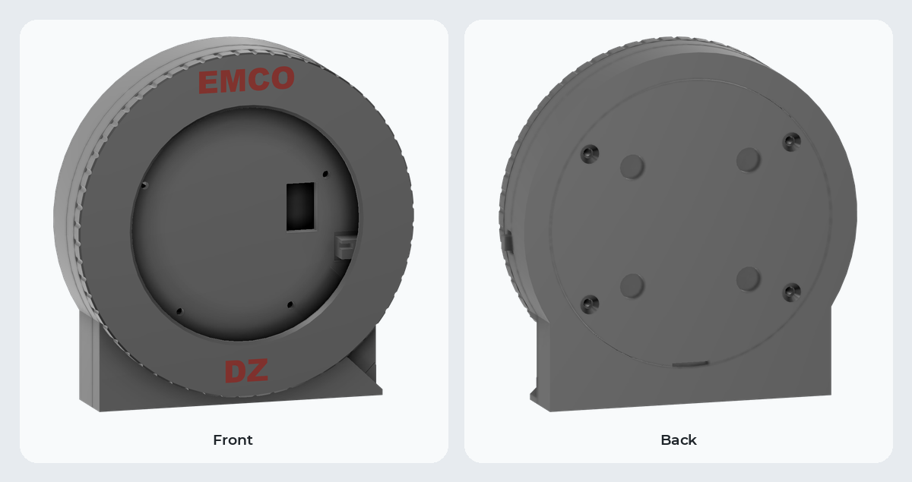

# LinuxCNC Wireless Display

A small round display that sits on the machine and shows live data from
LinuxCNC over Wi-Fi: spindle RPM, feed, XYZ position, spindle and coolant
state. I built it for my EMCO F1-CNC, but nothing in it is specific to that
mill apart from the logos and the example HAL file.

<p align="center">
  
  
  
</p>

The images above are rendered by the actual firmware code (LVGL running on a
PC), not mock-ups.

Video of the build and the display working on the machine (in Spanish, with
English audio track and subtitles): https://youtu.be/hc-3DxGRdGc

## What it does

- **Classic page**: analog style RPM gauge with a warning arc, feed in
  mm/min, machine X/Y/Z, spindle and coolant indicators and a battery icon.
- **DRO page**: work or machine coordinates with three decimals, active
  G54..G59.3 system, and optional per-axis zeroing (G10 L20).
- **Spindle page**: optional speed slider, -100/+100, Start and Stop.
- Tap the DominicZe logo at the top to cycle through the pages.
- Optional over-the-air firmware updates, served by the LinuxCNC PC itself.

Out of the box it is **read only**. The control features (zeroing and
spindle) stay locked until you set the same private pairing key on both
sides. See [docs/CONTROL_CHANNEL.md](docs/CONTROL_CHANNEL.md) before you even
think about turning them on.

## How it works

```text
LinuxCNC / HAL signals
        |  read-only HAL_IN pins
        v
panel_wifi  (loadusr, normal Linux user process, Python stdlib only)
        |  UDP, 25 snapshots per second
        v
PC Wi-Fi --- home router --- Waveshare ESP32-S3 (LVGL, 480x480)

PC Ethernet ------------------ Mesa card (untouched, no display traffic)
```

- Nothing runs in the servo or base thread. `panel_wifi` is a userspace HAL
  component loaded with `loadusr`.
- No MQTT broker, no cloud, no fixed IP addresses. The display finds the PC
  with a local broadcast "hello" and then gets unicast packets. Both ends can
  use DHCP.
- Traffic is pinned to the Wi-Fi interface with `IP_PKTINFO`. It never goes
  out through the Mesa Ethernet link, and the sender refuses to start if the
  Wi-Fi subnet overlaps the Mesa one.

The full engineering description (requirements, block diagrams, every
module and function, state machines, message sequences, bit-level formats
and the reasoning behind each decision) is in [docs/design](docs/design/00-overview.md).

## Hardware

| Part | Notes |
|---|---|
| Waveshare **ESP32-S3-Touch-LCD-2.8C** | Round 480x480 IPS, ST7701S + GT911 touch, 16 MB flash, 8 MB octal PSRAM. Not the 2.8 or 2.8B variants. |
| LinuxCNC PC with Wi-Fi | Any Linux running LinuxCNC 2.9 or newer (uspace). Tested with Probe Basic. |
| 3D printed enclosure | STEP, Fusion 360 and STL files in [hardware/enclosure](hardware/enclosure). |
| LiPo cell (optional) | Plugs into the board's battery connector. The icon is an estimate, see [docs/BATTERY.md](docs/BATTERY.md). |

<p align="center">
  
</p>

## Getting started

1. **Firmware**: build it with ESP-IDF 5.3.2 and flash it over USB, then
   store your Wi-Fi settings in NVS. [docs/FIRMWARE.md](docs/FIRMWARE.md)
2. **LinuxCNC side**: copy this repo to the machine, write `local/host.json`,
   add `panel_wifi.hal` to your INI. Step by step in
   [docs/LINUXCNC_SETUP.md](docs/LINUXCNC_SETUP.md).
3. **Try it without touching HAL first**:

   ```sh
   python3 run_panel.py --demo --config local/host.json
   ```

   The display shows DEMO and fake data. Ctrl+C and within a second it
   switches to NO DATA.

If something doesn't show up, [docs/TROUBLESHOOTING.md](docs/TROUBLESHOOTING.md)
has the usual suspects.

## Repository layout

| Folder | What's inside |
|---|---|
| `host/panel_wifi/` | HAL component and UDP sender (Python, standard library only) |
| `firmware/` | ESP-IDF 5.3.2 application for the display |
| `config/` | Example `host.json` and `panel_wifi.hal` files |
| `hardware/enclosure/` | Enclosure CAD and STL files |
| `tools/` | Asset generators, NVS provisioning, OTA publishing, demo G-code |
| `gcode/` | Air-cutting demo program that exercises every value on the display |
| `tests/` | Python and C tests, plus a native LVGL render test |
| `docs/` | Everything else |

## Documentation

- [LinuxCNC setup](docs/LINUXCNC_SETUP.md)
- [Building and flashing the firmware](docs/FIRMWARE.md)
- [Design documentation](docs/design/00-overview.md): how and why it is built this way.
  Also available as a single PDF attached to each
  [release](https://github.com/DominicZe-DZ/linuxcnc-wireless-display/releases)
  (built with `tools/design-pdf`).
- [UDP protocol](docs/PROTOCOL.md)
- [Optional control channel](docs/CONTROL_CHANNEL.md)
- [Over-the-air updates](docs/OTA.md)
- [Battery indicator](docs/BATTERY.md)
- [Troubleshooting](docs/TROUBLESHOOTING.md)
- [Development, tests and the demo program](docs/DEVELOPMENT.md)

## License

- Software (everything outside `hardware/`): [MIT](LICENSE).
- Enclosure design in `hardware/`: [CC BY 4.0](hardware/LICENSE.md).
- Montserrat font: SIL Open Font License, see `assets/fonts/OFL.txt`.
- The DominicZe logo is not covered by either license. EMCO is a trademark of
  its owner; this project is not affiliated with or endorsed by EMCO,
  Waveshare or the LinuxCNC project. See [assets/README.md](assets/README.md).

## Author

Raúl Milla, **DominicZe**
Web: https://dominicze.com
YouTube: https://www.youtube.com/@DominicZe

Questions and ideas are welcome on the
[LinuxCNC forum](https://forum.linuxcnc.org/) or in the issues here.
