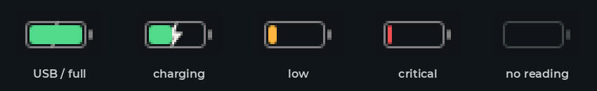

# Battery indicator

The ESP32-S3-Touch-LCD-2.8C has a LiPo connector and a charger on board. The
icon at the bottom of every page shows an estimate of the charge.

<p align="center"></p>

## What the board gives us

From the [Waveshare wiki](https://www.waveshare.com/wiki/ESP32-S3-Touch-LCD-2.8C)
and the official schematic:

- `BAT_ADC` on **GPIO4**, through a 200k / 100k divider (ratio 3).
- ETA6098 charger. Its STAT output is **not** wired to the ESP32.

So the only thing the firmware knows is the cell voltage. There is no charge
current, no "USB present" and no "cell present" signal.

## How it is measured

`battery.c` reads ADC1 once per second from the main loop (eight samples,
averaged, using the IDF calibration curve). ADC1 can be used while Wi-Fi is
running. `battery_model.c` filters the voltage (about 10 s to settle on a
step) and maps it to a percentage with a typical 3.7 V LiPo curve.

That percentage is a rough indication. Load, temperature, cell age and the
charge current all move the voltage.

### The charging bolt

With no charger signal, "charging" is a guess:

- plugging in makes the voltage jump by 35 mV or more within 10 s
  (unplugging drops it the same way);
- if the display boots already plugged in, the 5 minute trend goes up;
- above 4.17 V it assumes USB power, since a cell feeding the display falls
  below that within seconds.

Short dead times after an unplug avoid flicker, but it can still be fooled:
a change in load or a cell recovering after a heavy draw can look like
charging. **On USB with no cell at all you will see 100 % with the bolt.**
That doesn't mean a cell is there.

## Options (menuconfig)

| Option | Default | |
|---|---|---|
| `PANEL_BATTERY` | on | Show and read the battery |
| `PANEL_BATTERY_GPIO` | 4 | BAT_ADC pin, must be an ADC1 channel |
| `PANEL_BATTERY_DIVIDER_X1000` | 3000 | Divider ratio x1000 |

With the option off the ADC is never touched. Without eFuse calibration, or
with a voltage outside the LiPo range, the icon shows "no reading".

## Calibrating

Measure the cell with a multimeter and compare with the voltage in the USB
log (`battery: 3.98 V, 78 %, not charging`):

```text
new ratio = current ratio x measured voltage / logged voltage
```

The icon doesn't replace the protection circuit of the cell. Use a cell with
its own protection board and check the connector polarity, Waveshare boards
and generic LiPo leads don't always agree.
