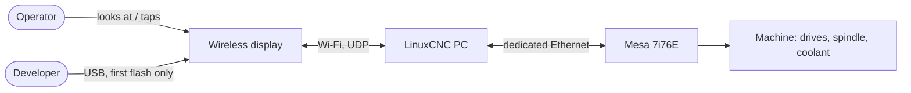
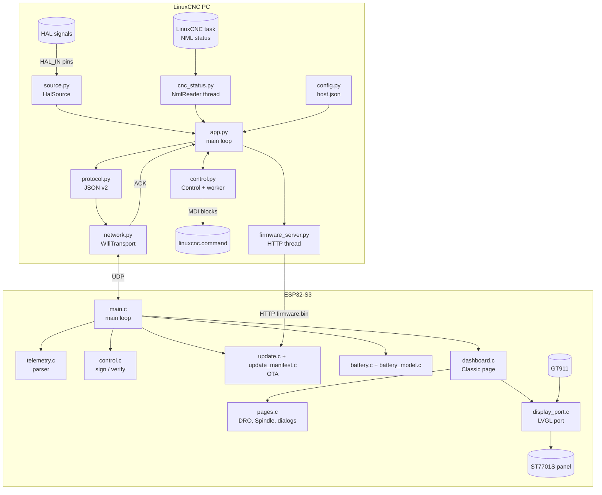

# 02 System architecture

## Context



The display only ever talks to the LinuxCNC PC. The PC is the only thing
that talks to the machine, exactly as before.

## Hardware blocks

```text
 +-------------------- LinuxCNC PC --------------------+
 |                                                     |
 |  CPU (realtime kernel)                              |
 |   |- servo thread --- hm2_eth ---- Ethernet port ---+---- Mesa 7i76E ---- machine
 |   |                                                 |     (10.10.10.0/24)
 |   '- userspace ----- panel_wifi -- Wi-Fi card ------+~~~~ home router (2.4 GHz)
 |                                                     |          ~
 +-----------------------------------------------------+          ~
                                                                  ~
 +------------- Waveshare ESP32-S3-Touch-LCD-2.8C ---------------~+
 |                                                                |
 |  ESP32-S3 (2 cores, 240 MHz)  -- Wi-Fi radio                   |
 |    |- 16 MB flash: bootloader, NVS, 2 x 3 MB app slots         |
 |    |- 8 MB octal PSRAM: framebuffer 480x480 RGB565             |
 |    |- RGB parallel bus ----> ST7701S 480x480 round IPS          |
 |    |- I2C ----> GT911 touch, TCA9554 I/O expander              |
 |    '- ADC1 (GPIO4) <---- 200k/100k divider <---- LiPo cell     |
 |  ETA6098 charger, USB-C power/programming                      |
 +----------------------------------------------------------------+
```

## Two networks, kept apart

| | Mesa link | Display link |
|---|---|---|
| Interface | Ethernet (e.g. `eno1`) | Wi-Fi (e.g. `wlp2s0`) |
| Subnet | 10.10.10.0/24 (example) | home LAN, DHCP |
| Traffic | hm2_eth, realtime, every servo period | UDP 27180/27181, TCP 27190 for OTA |
| Owner | LinuxCNC realtime | `panel_wifi` userspace |

The separation is enforced in software (SR-3): the sender checks that its
interface is wireless, that the subnets don't overlap, filters incoming
packets by interface index and pins every outgoing packet to the Wi-Fi
interface with `IP_PKTINFO` (see [03](03-host.md#networkpy) and
[D-5](08-decisions.md#d-5-pin-traffic-to-the-wi-fi-interface)).

## Software blocks



## Data flow of one sample

```text
 HAL signal ──> panel_wifi.x pin ──> HalSource.read() ──┐
 linuxcnc.stat ──> NmlReader thread ──> snapshot ───────┤
                                                        v
                         app.run(): values + ui ──> protocol.sample_message()
                                                        │ dict
                                                        v
                                        protocol.encode() -> JSON bytes (<=1200)
                                                        │
                                                        v
                         WifiTransport.send(): sendmsg + IP_PKTINFO (Wi-Fi only)
                                                        │ UDP 27180 -> 27181
                                                        v
     main.c: recvfrom -> source filter -> panel_decode() -> sequence check
                                                        │ panel_sample_t
                                                        v
                 every 40 ms: dashboard_update() -> pages_update()
                                                        │ only changed objects
                                                        v
            LVGL renders dirty areas -> flush_cb -> framebuffer -> panel
```

Latency budget (typical): HAL read to packet out < 1 ms; Wi-Fi 2-10 ms;
parse < 1 ms; wait for the next 40 ms draw slot 0-40 ms; render and copy a
needle move a few ms. So a change shows up roughly 10-60 ms later, well
inside NFR-1. Nothing here is guaranteed, and it doesn't need to be.

## Where things run

| Side | Thread / task | Does |
|---|---|---|
| PC | `panel_wifi` main thread | loop at `rate_hz`, network, HAL reads, control admission |
| PC | NmlReader thread | `stat.poll()` every 40 ms, keeps last snapshot |
| PC | control worker (1 thread) | MDI sequence of an admitted command |
| PC | recovery thread (short-lived) | switches an idle MDI back to manual |
| PC | HTTP server thread | serves the firmware image (only with a key) |
| Display | `main` task | the whole application loop, LVGL included |
| Display | IDF tasks | Wi-Fi driver, TCP/IP stack, event loop, esp_timer |
| Display | interrupts / DMA | RGB panel scan-out from the framebuffer |

## Configuration and secrets

| Item | PC | Display |
|---|---|---|
| Machine ID | `host.json` `machine_id` | NVS `panel/machine_id` (fallback menuconfig) |
| Screen ID | `host.json` `screen_id` | its own Wi-Fi MAC, read at boot |
| Wi-Fi | system network manager | NVS `panel/ssid`, `panel/password` |
| Pairing key | `host.json` `control_key` | NVS `panel/control_key` |
| Ports | `host.json` | menuconfig |

`host.json` and the NVS image live in `local/`, which Git ignores (NFR-6).
