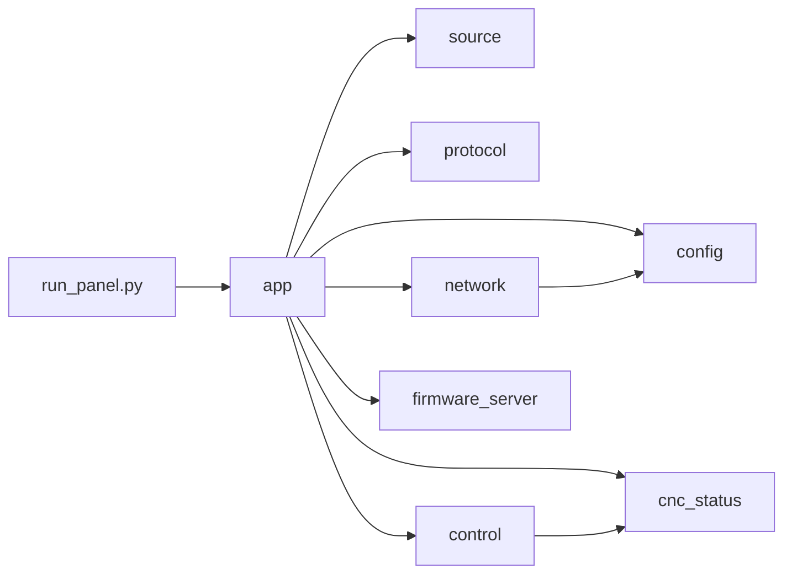

# 03 Host software (`panel_wifi`)

Python 3, standard library only (C-6). Lives in `host/panel_wifi/`, started
by LinuxCNC through `loadusr -Wn panel_wifi ... run_panel.py --config ...`.

## Module map



| Module | Responsibility | Talks to |
|---|---|---|
| `config.py` | Load and validate `host.json` before anything else is created | file system |
| `source.py` | HAL pins (or fake data in demo) | `hal` module |
| `cnc_status.py` | LinuxCNC status: permission state, WCS, work coordinates | `linuxcnc.stat` |
| `protocol.py` | Wire format: build, check and encode JSON | nothing |
| `network.py` | Wi-Fi-only UDP socket, discovery filters | kernel sockets, `ip` command |
| `control.py` | Optional command channel: tokens, signatures, MDI execution | `linuxcnc.command` |
| `firmware_server.py` | HTTP server for OTA images | file system, TCP |
| `app.py` | Main loop tying it all together, logging, signals | all of the above |

Rule: each module does one thing. `network.py` knows nothing about the
machine, `protocol.py` knows nothing about sockets, `source.py` never
writes HAL. That's what makes them testable one by one (see
[09](09-verification.md)).

## Functions

### config.py

| Function | In | Out | Notes |
|---|---|---|---|
| `Config.load(path)` | JSON file | `Config` (frozen) | Unknown keys -> TypeError. Validates interface name, IDs, ports, rate, scale, key, Mesa network. Fails before any pin or socket exists. |
| `Config.data_path()` | | `Path` | `data_dir` expanded, or `<repo>/local` |

### source.py

| Function | In | Out | Notes |
|---|---|---|---|
| `HalSource()` | | | Creates component `panel_wifi` with 9 `HAL_IN` pins, calls `ready()` immediately (never waits for the network). |
| `HalSource.read(now)` | | `(values, enabled)` | `coolant = coolant OR coolant_mist`. |
| `DemoSource.read(now)` | time | `(values, True)` | Sine waves; never imports `hal`. |

### cnc_status.py

| Function | In | Out | Notes |
|---|---|---|---|
| `work_position(stat)` | polled stat | `[x, y, z]` mm | Offsets, rotation, G92, units. Formula in the docstring. |
| `permission(stat, cnc, mode)` | polled stat | state word | Fail closed, ordered checks. Table in the docstring. |
| `CncStatus.read()` | | ui dict | Blocking `stat.poll()`. Used by the worker. |
| `NmlReader` | | | Thread polling every 40 ms; `read()` returns the snapshot or `None` if older than 2 s. |

### protocol.py

| Function | In | Out | Notes |
|---|---|---|---|
| `encode(message)` | dict | bytes | `allow_nan=False`, ASCII, compact, raises above 1200 bytes. |
| `hello_nonce(packet, machine, screen)` | bytes | nonce or `None` | Exact v2 hello for this pair only. |
| `sample_message(...)` | values | dict | Type check per channel; bad values become `null`. |

### network.py

| Function | In | Out | Notes |
|---|---|---|---|
| `inspect_link(config)` | | `Link` | Runs `ip -j -4 addr show dev <if>` (only at start and every 2 s). Checks wireless, overlap with Mesa, usable address. |
| `WifiTransport()` | config | | UDP socket bound to 0.0.0.0:27180, `IP_PKTINFO` on, non-blocking. |
| `check_link(now)` | | | Every 2 s; raises if the link changed so `app` rebuilds it. |
| `receive()` | | `None` / `(b"", None)` / `(packet, addr)` | `recvmsg` with ancillary data; filters interface index, port, subnet, truncation. |
| `select(addr)` | | | Remembers the display address learned from a hello. |
| `send(packet)` | bytes | | `sendmsg` with `in_pktinfo` = Wi-Fi index + source IP. |

### control.py

| Function | In | Out | Notes |
|---|---|---|---|
| `canonical(msg)` / `signature(msg, key)` | dict | bytes / hex | Fixed field order, HMAC-SHA256. |
| `Control.update(ui, nonce)` | ui dict | ui dict + token/allowed | New 1 s token when nonce, state or WCS change or it expires. |
| `Control.receive(packet)` | bytes | ACK dict or `None` | Verify, de-duplicate (128 records), check token/state/WCS, admit to the worker, answer `pending` or a rejection. |
| `Control.poll()` | | ACK dict or `None` | Final ACK when the worker is done; token reset. |
| `Control.auto_recover(state, now)` | | | After 5 s of idle `mode`, up to 3 tries to switch back to manual in a thread. |
| `MdiExecutor.execute(req)` | admitted request | result word | The MDI sequence, see [05](05-state-machines.md#command-pc-side). |

### firmware_server.py

| Function | In | Out | Notes |
|---|---|---|---|
| `load_record(store)` | folder | `(bytes, record)` | `display.bin` + `display.json`; checks version format, size 1 KiB..3 MiB, SHA-256. |
| `FirmwareHandler.do_GET` | | HTTP | `/manifest.json` and `/firmware.bin` only, manifest signed per request with the current nonce. |
| `start_server(...)` | | `(server, record)` | Only with a control key. |

### app.py

| Function | Notes |
|---|---|
| `configure_logging(folder)` | `runtime.log` in the data folder, console as fallback. |
| `start_firmware_server(config, control)` | Retries the bind 10 times (old instance still closing). |
| `run(config, demo)` | Main loop, below. |
| `main()` | Arguments, config, logging, `run`. |

## Main loop

```text
period = 1 / rate_hz                         (40 ms at 25 Hz)
loop until SIGTERM / SIGINT:
    if no transport and retry time reached:  create WifiTransport, or retry in 2 s
    if transport:
        check_link (every 2 s)
        up to 8 times: receive()
            hello for our pair     -> select(address), nonce = hello nonce, last_hello = now
            other, from the display -> control.receive() -> send ACK if any
        if a hello arrived in the last 3 s:
            values, valid = source.read()
            spindle_on |= |rpm| > 0.05 rev/s            (real rotation)
            rpm *= rpm_input_scale
            ui = NmlReader snapshot (or 'unknown' state)
            ui = control.update(ui, nonce)
            + signed firmware offer if one is published
            send(sample)
            send(control.poll()) if a command finished
            seq = (seq + 1) mod 2^32
        on network error: close transport, retry in 2 s
    sleep to the next deadline; if late, skip ahead (no catch-up burst)
```

Cost per cycle: 9 pin reads, a dict copy of the NML snapshot, one
`json.dumps` of ~400 bytes, one `sendmsg`. A few hundred microseconds of CPU
at 25 Hz (NFR-4).

### Why "a hello in the last 3 s"

The display sends a hello every second. If three are missed the display is
gone (off, out of range); the PC stops sending so it doesn't spray packets
at an address that may now belong to someone else, but keeps listening
forever (FR-14).

## Threads and shared data

| Data | Written by | Read by | Protection |
|---|---|---|---|
| `NmlReader.snapshot`, `stamp` | NML thread | main loop | Python reference assignment is atomic; `read()` copies the dict. |
| `Control.spindle_running` | main loop | worker | Single bool assignment; worker also gets a snapshot at admission. |
| `Control.future`, `pending` | main loop | main loop | Only touched from the main loop; the pool runs `execute`. |
| `Control.executor` | worker / recovery | worker / recovery | `executor_lock`. |
| `Control.nonce` | main loop | HTTP thread | String reference, read only. |

There is no shared mutable structure that two threads modify.

## Timing constants

| Constant | Value | Where | Why |
|---|---|---|---|
| send rate | 25 Hz (1-100) | `rate_hz` | Smooth needle, low load |
| receive budget | 8 datagrams per cycle | `app.py` | A flood can't starve the loop |
| hello timeout | 3 s | `app.py` | 3 missed hellos |
| link check | 2 s | `network.py` | Notice DHCP changes without polling `ip` per sample |
| NML poll | 40 ms, stale after 2 s | `cnc_status.py` | Same pace as the display |
| token life | 1 s | `control.py` | A token can't be reused later |
| command budget | max(0.7 s, token expiry) | `control.py` | Enough for MDI switch + block |
| MDI waits | 2 s each | `control.py` | `wait_complete(2)` |
| ACK records | 128 | `control.py` | Replay window much longer than a session needs |
| auto recover | after 5 s, max 3 tries | `control.py` | Don't fight a user who is in MDI on purpose |
