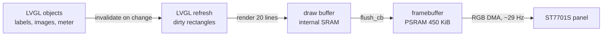

# 04 Firmware

ESP-IDF 5.3.2, C11, LVGL 8 (taken from the Waveshare demo together with the
board drivers, see `tools/prepare_firmware.py`). Source in `firmware/main`.

## Execution model

One task, one loop (`app_main` in `main.c`), every 5 ms. LVGL is not
thread-safe, and the simplest way to never get that wrong is to have only
one thread that touches it. Network I/O is non-blocking so it fits in the
same loop. The ESP-IDF Wi-Fi driver, TCP/IP stack, event loop and timers run
in their own tasks; they reach our code only through the Wi-Fi event
handler (which just bumps a counter) and through sockets.

```text
app_main()
  I2C_Init, EXIO_Init, LCD_Init, set PCLK 8 MHz, Touch_Init, LVGL_Init
  dashboard_init()  -> builds Classic page, then pages_init() for DRO/Spindle
  battery_init()
  wifi_init()       -> NVS, station mode, connect (asynchronous)
  read NVS: control_key, machine_id; build screen ID from the MAC
  loop every 5 ms:
     1  Wi-Fi changed?             -> close socket, new nonce
     2  no valid sample for 1 s?   -> new nonce, forget PC
     3  command older than 2.5 s?  -> "timeout"
     4  socket missing?            -> open UDP :27181 (retry every 2 s)
     5  1 s since last hello?      -> hello (broadcast until the PC is known)
     6  up to 8 datagrams          -> ACK of our command / telemetry sample
     7  newer signed image offered, idle manual?  -> start OTA
     8  battery_poll()             (1 Hz inside)
     9  40 ms since last draw?     -> dashboard_update + dashboard_battery
    10  OTA running?               -> progress, restart on DONE, recover on FAIL
    11  lv_timer_handler()         -> touch input + rendering
    12  command queued by a page?  -> sign + send, or report "dropped"
```

Loop period is 5 ms (`vTaskDelay`), so up to ~200 passes per second.
Drawing is limited to 25 per second (40 ms) and decoupled from packet
arrival.

## Modules

| File | Responsibility | Depends on |
|---|---|---|
| `main.c` | Start-up, Wi-Fi, NVS settings, the main loop, packet routing | everything below |
| `telemetry.c/.h` | Parse and validate v2 samples into `panel_sample_t` | cJSON |
| `control.c/.h` | Build signed commands, verify signed ACKs | cJSON, mbedTLS |
| `update_manifest.c` | Verify the signed firmware offer | cJSON, mbedTLS |
| `update.c/.h` | OTA download state machine | lwIP sockets, esp_ota, mbedTLS SHA-256 |
| `battery.c/.h` | ADC reading | esp_adc |
| `battery_model.c` | Filter, percentage, charging estimate (pure) | nothing |
| `dashboard.c/.h` | Classic page, battery icon | LVGL, assets |
| `pages.c/.h` | DRO and Spindle pages, dialogs, lock and OTA screens, command queue | LVGL, control.h |
| `display_port.c` | LVGL display and touch driver glue | LVGL, esp_lcd, GT911 driver |
| `*_assets.h`, `dz_logo.h` | Generated images (alpha masks, needle) | generated by `tools/` |
| `font_*.c` | Generated Montserrat subsets | generated by `tools/generate_fonts.sh` |
| `version.h` | Build ID (short commit hash) | generated by `tools/generate_version.py` |

Pure modules (no ESP-IDF calls): `telemetry.c`, `control.c`,
`update_manifest.c`, `battery_model.c`. They are compiled and tested on a PC
in CI. `dashboard.c` and `pages.c` only use LVGL, so they are also run on a
PC against a memory framebuffer (`tests/render_dashboard.c`).

## Functions

### main.c

| Function | Notes |
|---|---|
| `app_main()` | Init order matters: panel before LVGL, LVGL before pages, Wi-Fi last so the screen shows NO WIFI while it connects. |
| `setting(key, fallback, out, cap)` | NVS string `panel/<key>`, or the menuconfig fallback. |
| `wifi_event(...)` | Event task: reconnect on start/disconnect, bump `wifi_generation`. |
| `wifi_init()` | Station, credentials in RAM only, power save off. |
| `new_nonce(out)` | 64 random bits from the hardware RNG as 16 hex chars. |
| `confirm_boot_once()` | Marks the image valid after the first good sample (cancels rollback). |

### telemetry.c

| Function | Notes |
|---|---|
| `panel_decode(json, len, nonce, machine, screen, out)` | All-or-nothing parse. Writes `out` only on success. |
| `panel_sequence_newer(a, b)` | Wrap-safe uint32 comparison (serial number arithmetic). |
| `hex16`, `hex_string`, `integer_in` | Format checks. |

### control.c

| Function | Notes |
|---|---|
| `panel_key_valid(key)` | 64 lower case hex. |
| `panel_command_encode(...)` | Canonical string -> HMAC -> JSON with `mac`. |
| `panel_ack_decode(...)` | Envelope match + constant-time MAC comparison. |
| `sign(body, key, mac)` | Hex key -> bytes, HMAC-SHA256, bytes -> hex, wipe key. |

### update_manifest.c / update.c

| Function | Notes |
|---|---|
| `panel_upd_parse(json, len, key, nonce, out)` | Checks offer format and its HMAC over `fw|version|size|sha256|nonce`. |
| `panel_upd_start(ip, port, manifest)` | Resets state, starts SHA-256, deadline 2 s for connect. |
| `panel_upd_poll(&percent)` | One step of the state machine ([05](05-state-machines.md#ota-download)). |
| `panel_upd_abort()` | Clean stop back to IDLE. |
| `upd_body`, `upd_finish`, `upd_fail` | Write+hash chunk / verify+switch slot / single error exit. |

### battery.c / battery_model.c

| Function | Notes |
|---|---|
| `battery_init()` | ADC1 one-shot on the BAT_ADC GPIO, 12 dB attenuation, eFuse curve calibration. |
| `battery_poll(now, &status)` | Once per second: 8 conversions averaged -> volts -> model. |
| `battery_model_feed(model, now, volts)` | Low-pass filter, 10 s step and 300 s trend detectors ([05](05-state-machines.md#battery-charging-estimate)). |
| `battery_percent_from_volts(v)` | Piecewise linear LiPo curve. |

### dashboard.c / pages.c

| Function | Notes |
|---|---|
| `dashboard_init()` | Creates every object of the Classic page once; then `pages_init`. |
| `dashboard_update(sample, fresh, wifi)` | Status text, needle angle, numbers, colours; only on change. |
| `dashboard_battery(status)` | Icon fill width, colour, bolt; only on change. |
| `pages_init(classic, logo)` | DRO and Spindle pages, dialogs, lock screen. |
| `pages_update(...)` / `refresh()` | Bring every object in line with sample + command state. |
| `request()` / `send_speed()` | Queue one command. |
| `pages_take_command()` / `pages_result()` | Hand-off with `main.c`. |
| `speed_event()` | Slider gestures (grab, relative drag, release, lost). |
| `ask_zero()` / `confirm_zero()` | Modal zero dialog bound to the WCS shown. |
| `pages_ota()` / `pages_ota_end()` | Update screen. |

### display_port.c

| Function | Notes |
|---|---|
| `LVGL_Init()` | 20-line draw buffer in internal RAM, partial refresh, touch input, 1 tick timer. |
| `example_lvgl_flush_cb()` | Copy a rendered chunk into the framebuffer; VSYNC sync on the first chunk of a refresh. |
| `example_touchpad_read()` | GT911 first touch point. |

## Memory

### Flash (16 MB)

```text
0x000000  bootloader + partition table
0x009000  nvs        24 KiB   Wi-Fi, machine ID, pairing key
0x00F000  otadata     8 KiB   which app slot boots, image states
0x011000  phy_init    4 KiB   radio calibration
0x020000  ota_0       3 MiB   application slot A
0x320000  ota_1       3 MiB   application slot B
0x620000  (free)
```

The app is about 1.25 MB, so each 3 MiB slot has ~60 % headroom.

### RAM

| Buffer | Size | Where | Why there |
|---|---|---|---|
| Framebuffer 480 x 480 x 2 bytes | 450 KiB | PSRAM | Too big for internal SRAM; scanned out continuously by DMA |
| LVGL draw buffer 480 x 20 x 2 | 18.75 KiB | internal SRAM | LVGL renders here; internal RAM is much faster |
| OTA state incl. 8 KiB buffer | ~8.5 KiB | static (.bss) | Never fails to allocate after long uptime |
| Receive packet buffer | 1202 B | static | Off the main stack |
| Main task stack | 16 KiB | internal | LVGL + cJSON + printf with floats overflowed the 3.5 KiB default |
| LVGL objects and styles | heap | `LV_MEM_CUSTOM` (malloc) | Created once at start-up, never freed |

No object is created or deleted after start-up, apart from the content of
the zero dialog when it opens. The heap doesn't fragment over time.

## Display pipeline



- Pixel clock 8 MHz. With the panel's porches that is about 29 frames per
  second of scan-out. Higher clocks made the image drift sideways under
  Wi-Fi load, because PSRAM bandwidth is shared between DMA, CPU and the
  radio buffers ([D-10](08-decisions.md#d-10-partial-refresh-one-framebuffer-8-mhz)).
- Bounce buffers: the driver moves PSRAM data through small internal
  buffers for the DMA, which survives short PSRAM stalls.
- `CONFIG_LCD_RGB_RESTART_IN_VSYNC`: if the DMA ever falls behind, it
  restarts at the next VSYNC instead of leaving the image shifted.

## Object tree

```text
lv_scr_act()
 |- classic_page (view 0)
 |   |- meter (ticks, red arc)        |- 6 scale labels
 |   |- brand (DominicZe, tap = next) |- EMCO mask, F1-CNC mask
 |   |- status label, rpm label, "RPM", feed label
 |   |- 3 axis cards (label inside)   |- spindle icon, coolant icon
 |   '- needle image, hub, centre dot (created last = on top)
 |- view 1 DRO
 |   |- header (logo tap = next, EMCO, F1-CNC, "DRO")
 |   |- WORK / MACHINE buttons, 3 rows (value + ">0"), "XYZ > 0", status
 |   '- dialog (modal zero confirmation, hidden)
 |- view 2 Spindle
 |   |- header ("SPINDLE")
 |   |- controls: SET SPEED number, status, slider + knob area, -100/+100, Start/Stop, feedback
 |   '- block (light lock screen / OTA screen, hidden)
 '- battery: body, tip, fill, bolt outline, bolt (raised above all pages)
```

## Touch handling

- Only the logos navigate. The background has no handler, so a stray touch
  never changes page or presses anything.
- The slider track ignores touches. Only a 90 x 44 px area around the knob
  is active, and dragging is relative to where it was grabbed, so the value
  never jumps under the finger.
- While dragging, a speed command goes out at most every 200 ms; if one is
  in flight the latest value is kept and sent when its ACK arrives.
- The zero dialog is modal (a full-screen clickable box) so nothing under it
  can be pressed.

## Start-up and failure behaviour

| Situation | Screen | Recovery |
|---|---|---|
| No credentials / wrong password | NO WIFI | Fix NVS, reboot |
| Wi-Fi up, PC silent | NO DATA | Hello every second, forever |
| PC sends `valid=false` | WAITING FOR HAL | Automatic when `enabled` goes true |
| Samples stop | NO DATA within 1 s, dashes everywhere | New nonce, rediscover |
| New image boots but never gets a sample | NO DATA | Rollback on next reset |
| `stack overflow` / panic | reboot | Watchdog / panic handler restarts |
