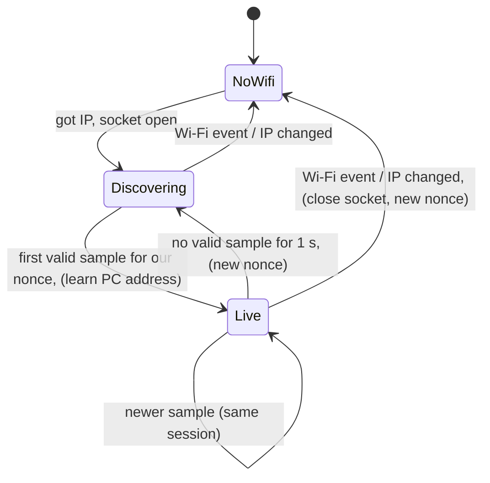
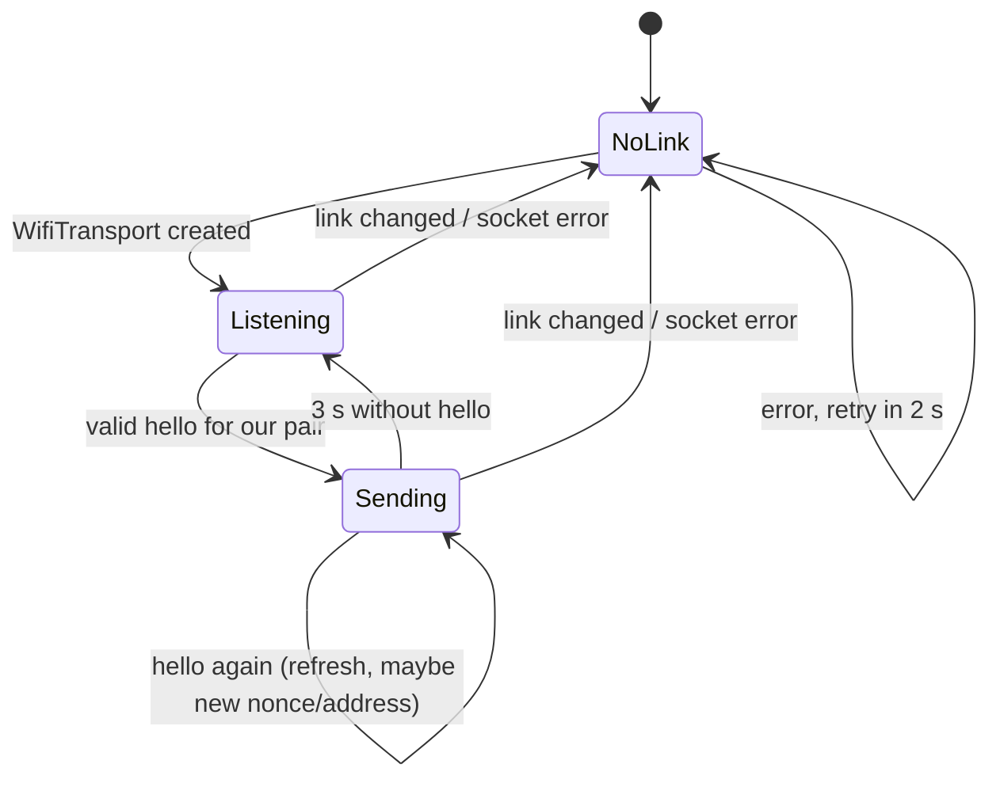
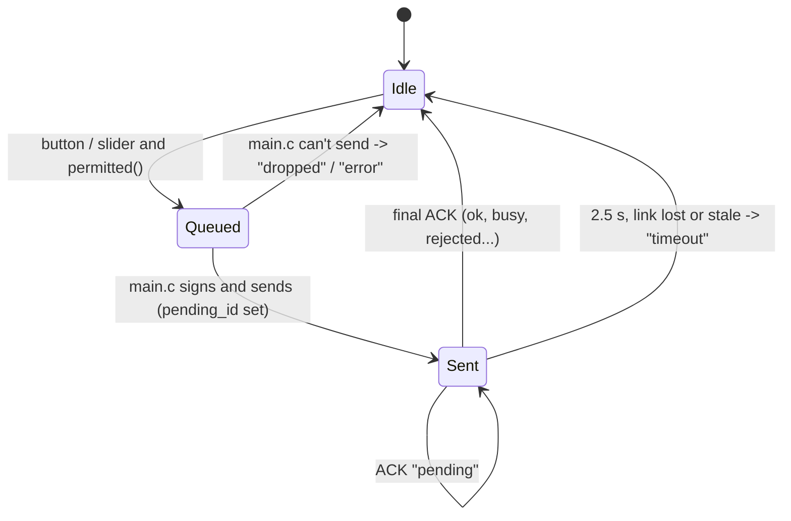
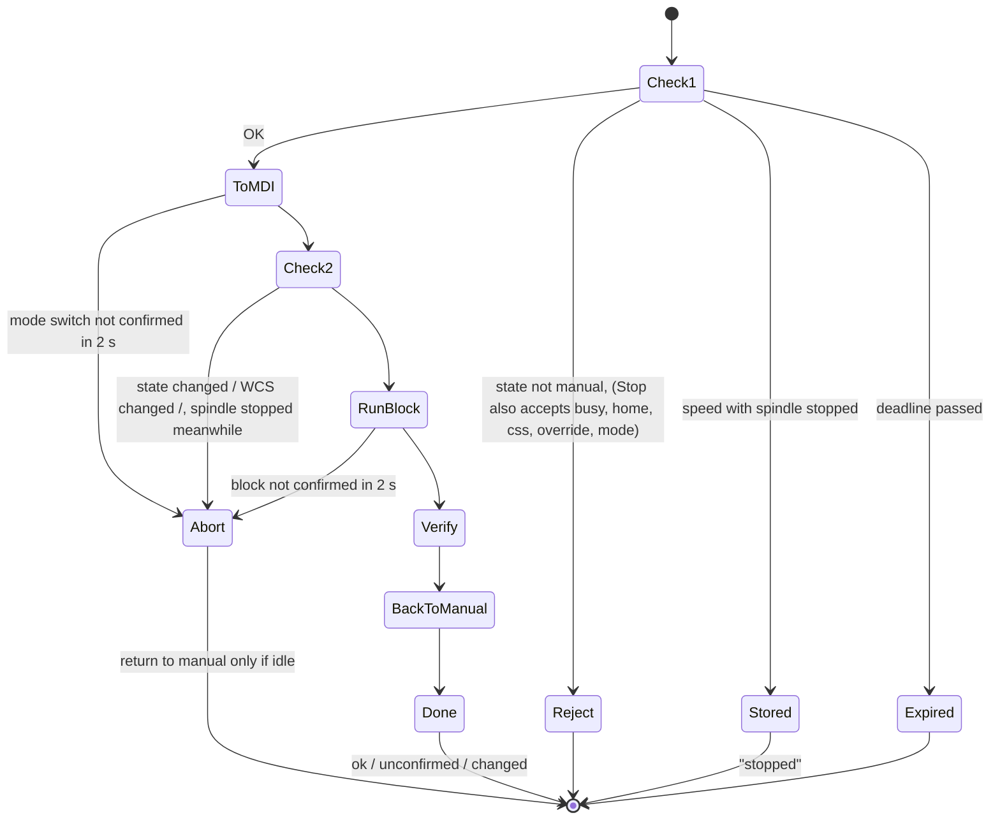
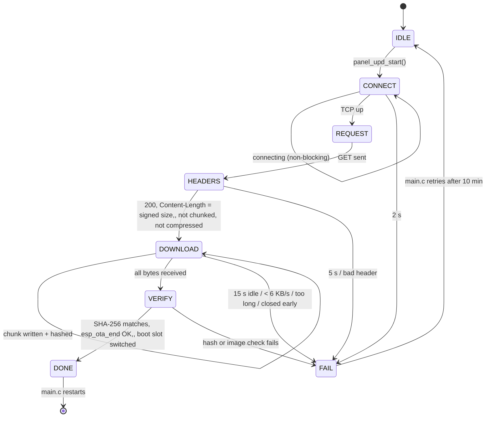
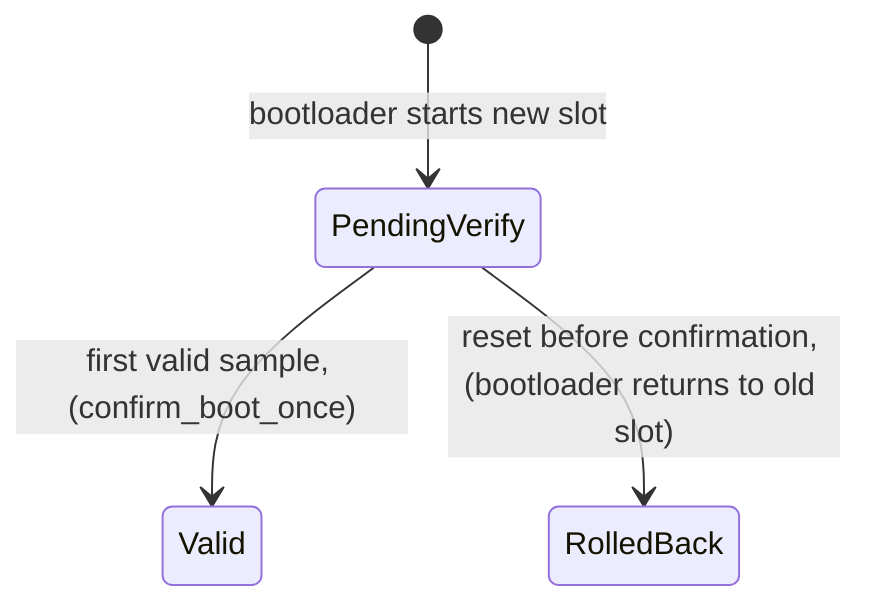
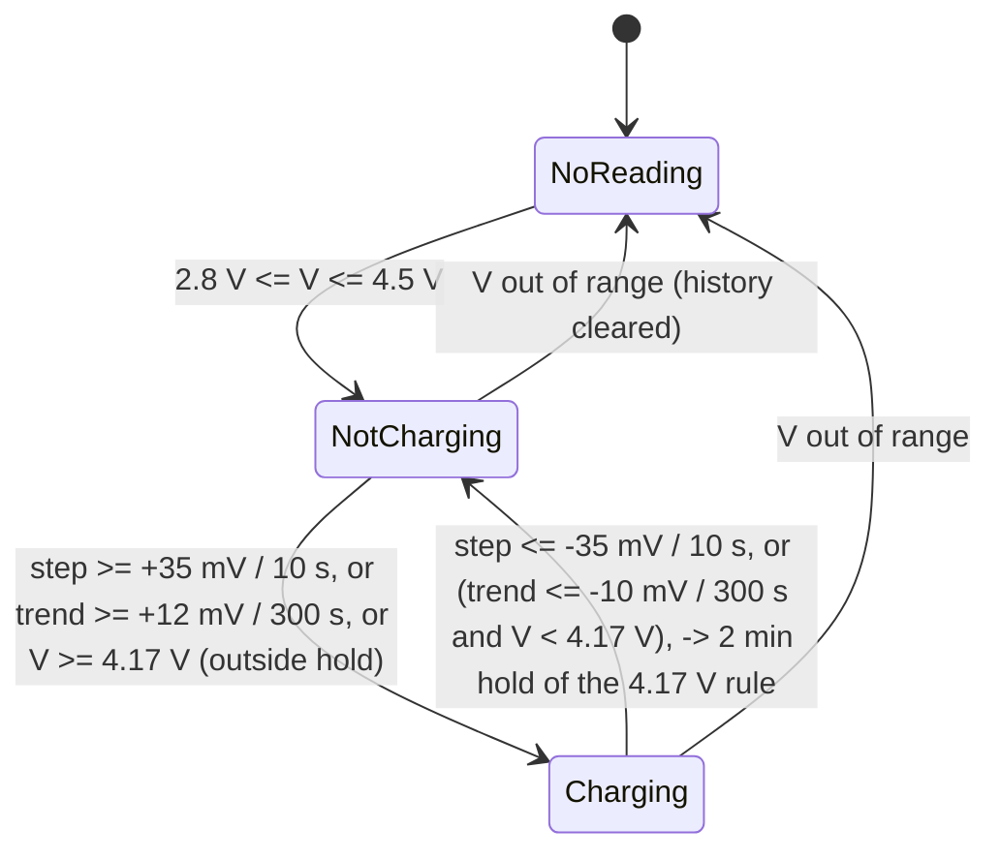
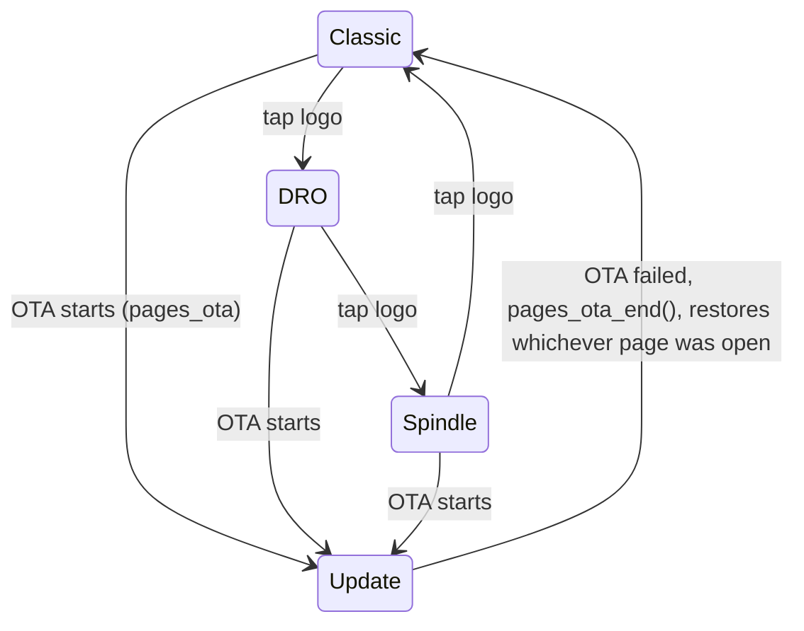

# 05 State machines

The code doesn't always have an explicit `state` variable for these; often
the state is a combination of a few flags. This chapter names the states so
the code can be read against them.

## Display link (main.c)

State = (`wifi`, `sock >= 0`, `host_known`, `have_sample`).



| State | Screen | Hello |
|---|---|---|
| NoWifi | NO WIFI | none |
| Discovering | NO DATA | broadcast, 1 per second |
| Live | CONNECTED / DEMO / WAITING FOR HAL | unicast to the PC, 1 per second |

Every way out of Live creates a new nonce. That is what makes any packet of
an earlier session unacceptable, even if it arrives late.

## PC link (app.py)

State = (`transport`, `nonce`, time since `last_hello`).



In Listening the PC sends nothing but keeps reading, so a display that
appears an hour later is picked up straight away.

## Command, display side (pages.c + main.c)



- Only one command can be Queued or Sent. Further slider moves set
  `pending_resync`; Stop pressed meanwhile sets `stop_queued`. Both are
  sent as soon as the state goes back to Idle.
- "timeout" is final: Start and zero are never resent (SR-7). Only a speed
  is re-sent, because sending the same speed twice is harmless.

## Command, PC side

### Admission (`Control.receive`, main thread)

```text
datagram
  |- key configured?                         no  -> ignore
  |- v3 command, our machine/screen/session/nonce, id format,
  |  action/axis/rpm/wcs in range, MAC correct?   no  -> ignore (no answer)
  |- (nonce, id) seen before?                yes -> same ACK again, if same MAC
  |- worker busy?                            yes -> ACK "busy"
  |- token current and not expired?          no  -> ACK "expired"
  |- state 'manual' or 'mode'?               no  -> ACK <state>
  |- zero and WCS changed?                   yes -> ACK "wcs"
  '- admit: remember speed, snapshot spindle rotation,
            submit to worker, ACK "pending"
```

A bad signature gets no answer at all: an attacker learns nothing.

### Execution (`MdiExecutor.execute`, worker thread)



"Verify" compares the effect with the request: new modal S, M3 or M5 as
expected, or the requested work coordinates now within 0.001 mm of zero.

## OTA download

Implemented in `update.c`.



After the restart:



## Battery charging estimate

Implemented in `battery_model.c`.



On entering Charging, the 300 s history is overwritten with the current
voltage so the same jump isn't counted again.

## Page navigation (pages.c)



On the Spindle page a light lock screen covers the controls while there is
no data, demo data, an old PC without `ui`, no pairing key, the machine is
off, or a program is running or paused.
