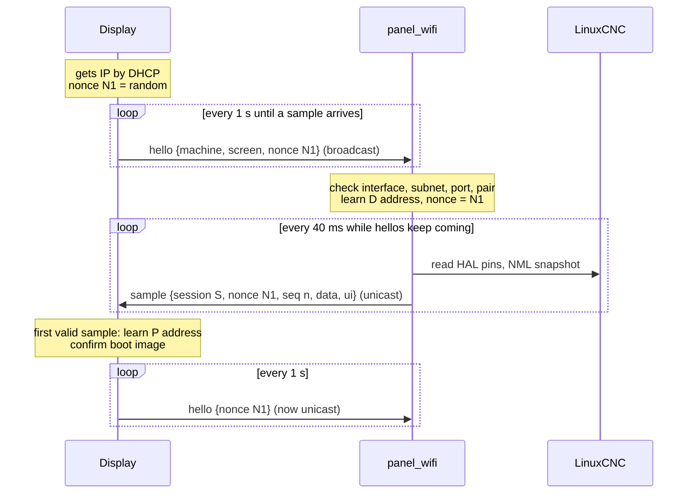
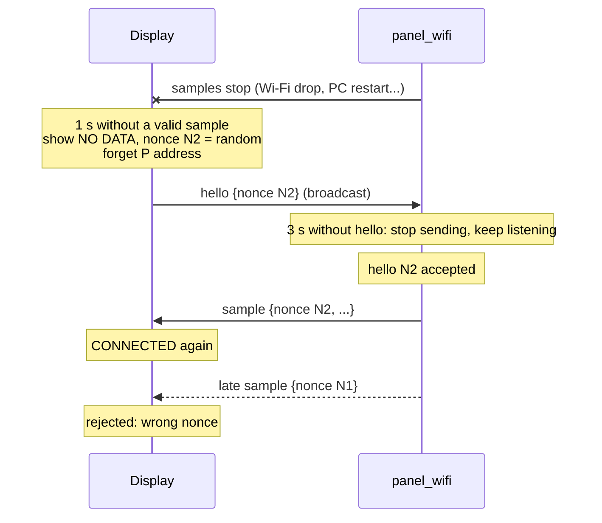
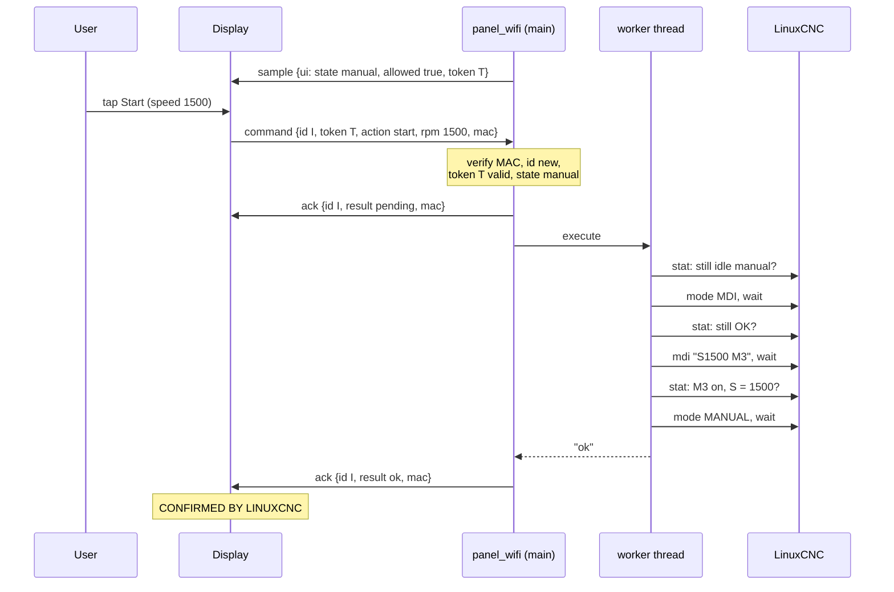
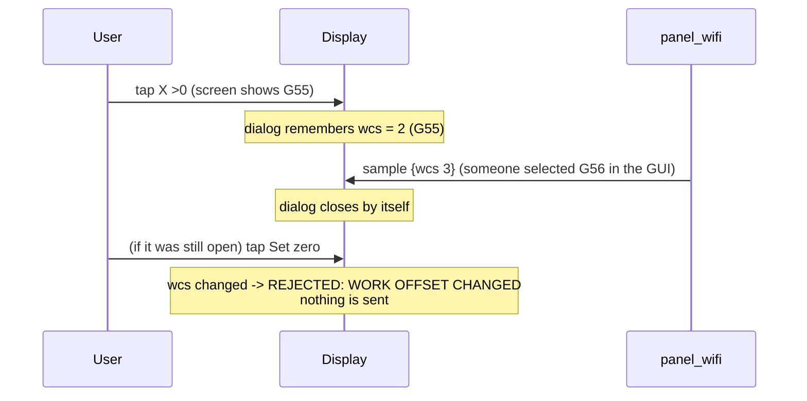
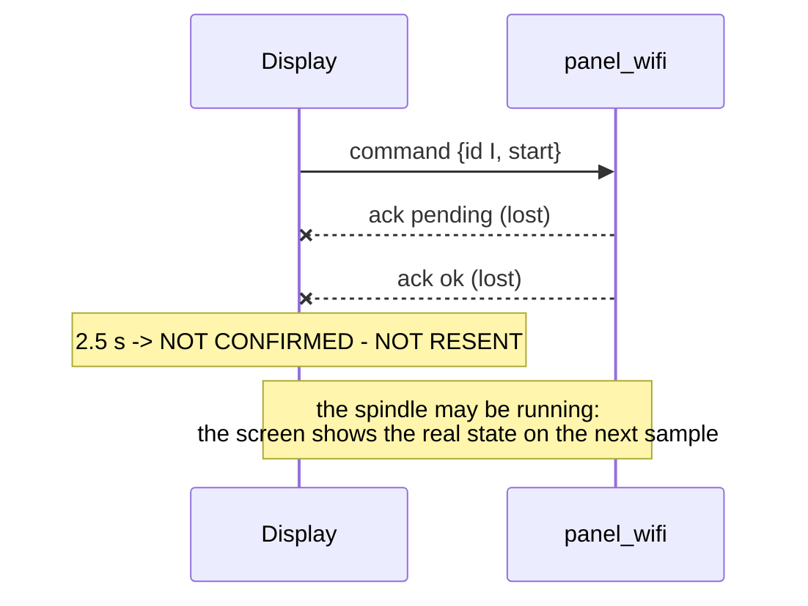
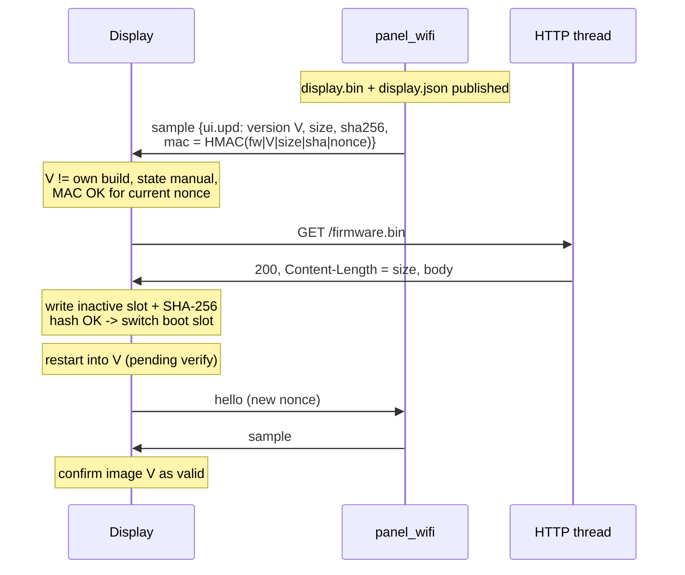

# 06 Sequences

Time goes down. `D` = display, `P` = PC (`panel_wifi`), `L` = LinuxCNC.

## Discovery and telemetry

## Losing and regaining the link

If the PC process restarted, its new samples carry a new session S2. The
display accepts them only after its own data went stale and it made a new
nonce, so two senders can never be mixed into one picture.

## Spindle start (control enabled)

While the worker runs, telemetry keeps flowing every 40 ms; the samples
show `state: remote` and `allowed: false`, so no second command can be
sent.

## Zero with a WCS change in between

If the change happens after the command left the display, the PC rejects
it with `wcs` (admission or second check), so a zero is only ever set in
the system the user saw.

## Lost ACK

If the same command datagram arrives twice (network duplicate), the PC
answers with the stored ACK and does not run it again.

## Firmware update

If V never gets a sample (it doesn't boot properly, or can't join the
Wi-Fi), the next reset rolls back to the previous image.
