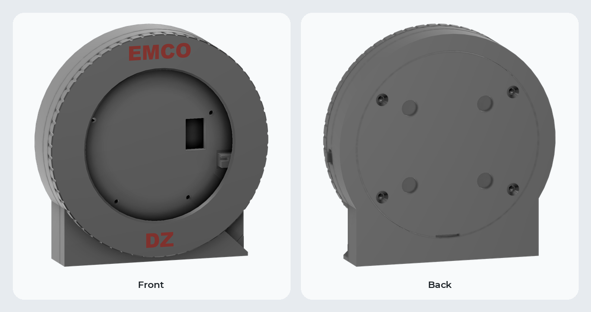
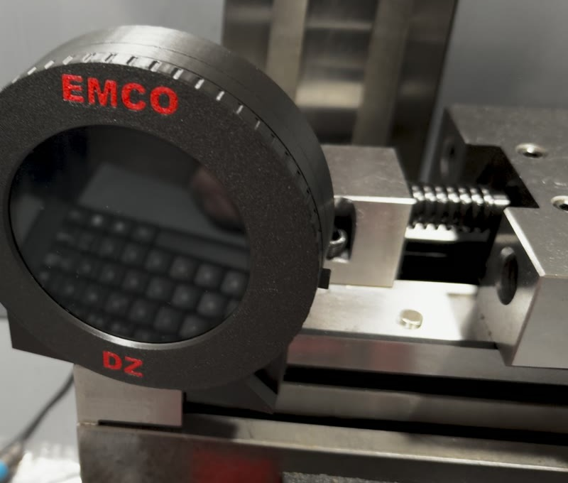

# Enclosure

3D printed housing for the Waveshare ESP32-S3-Touch-LCD-2.8C, designed in
Autodesk Fusion. Overall size, assembled: **111 x 112 x 27 mm**.

## Files

| File | Use |
|---|---|
| `enclosure.f3d` | Fusion archive, direct-edit bodies with their names |
| `enclosure.step` | Solid geometry for any other CAD |
| `enclosure.3mf` | All parts in assembly position, in mm, one object per part |
| `stl/` | One STL per part, ready for the slicer |

The parts are exported in their assembled position, so lay them flat on the
bed in the slicer before printing.

| STL | Qty | What it is |
|---|---|---|
| `front_shell.stl` | 1 | Front half, holds the display |
| `back_shell.stl` | 1 | Back half with the base |
| `front_bezel.stl` | 1 | Knurled ring around the screen |
| `battery_cover.stl` | 1 | Lid for the LiPo compartment |
| `power_button.stl` | 1 | Guided cap for the board's power switch |
| `alignment_pin_x4.stl` | 4 | Pins that align the two halves |
| `inlay_emco_red.stl` | 1 set | Red EMCO lettering (four letters) |
| `inlay_dz_red.stl` | 1 set | Red DZ lettering (two letters) |

The board itself, the screen and the LiPo cell are bought separately.

Measurements come from the CAD model. Check the fit of the board, the USB
connector access and the button travel with your own module before the
final assembly; printers and boards both vary a bit.

## License

[CC BY 4.0](../LICENSE.md), © 2026 Raúl Milla (DominicZe). The EMCO
lettering is a trademark of its owner, see the license file.
